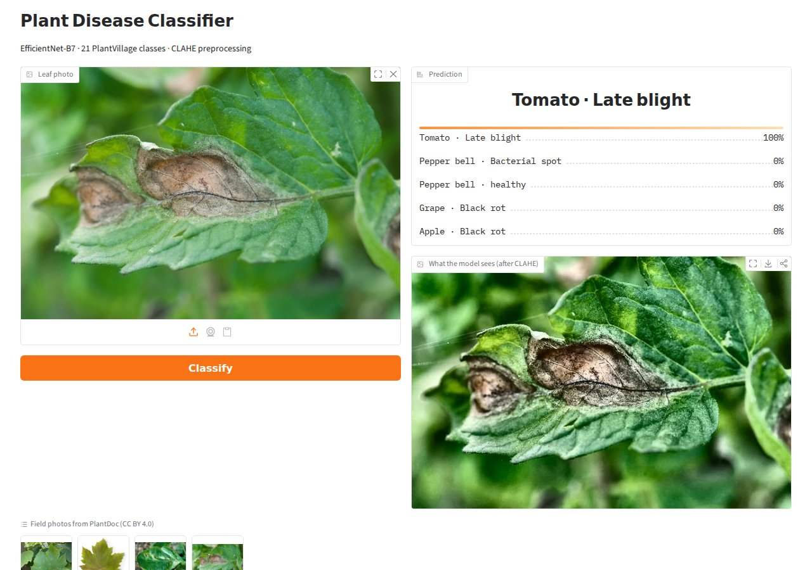
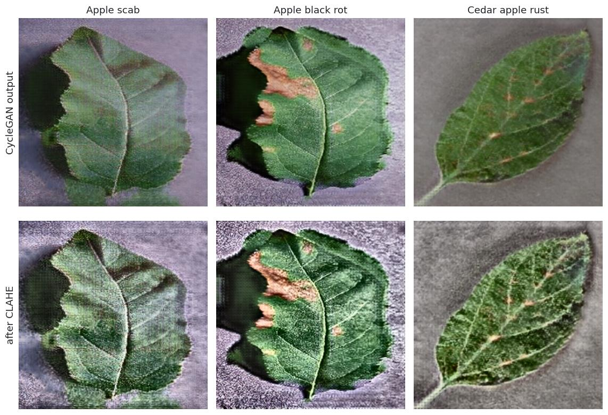
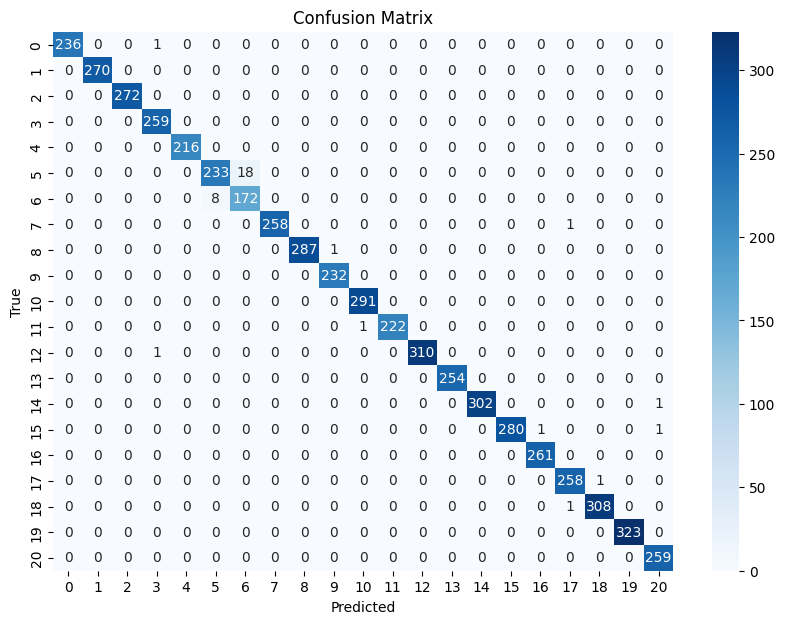
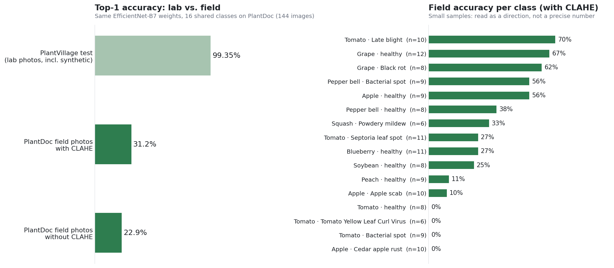

# Plant Disease Classification: CycleGAN Balancing, CLAHE and EfficientNet-B7

Classifies 21 plant diseases and healthy states from leaf photos (apple, grape, tomato,
pepper and more). Three ideas are combined:

- **CycleGAN** generates extra images for the rarest disease classes, turning healthy leaves into diseased-looking ones, to balance the dataset.
- **CLAHE** evens out lighting and brings out lesion texture before training and inference.
- **EfficientNet-B7**, fine-tuned from ImageNet, is compared against a MobileNet baseline and a DenseNet-161 reference.

The model reaches **99.35%** on the PlantVillage test split. On **real field photos it
reaches 31%**, which is the more useful number for anyone deploying a model like this.
That field evaluation, and an honest look at how the 99% was measured, are the main
points of this README.



## Results at a glance

| Model | Test accuracy (PlantVillage) | Notes |
|---|---|---|
| MobileNetV1 baseline, before CycleGAN | 97% | From the project report |
| MobileNetV1 baseline, after CycleGAN | 98.00% | Target Spot precision 0.79 → 0.96, F1 0.88 → 0.95 |
| DenseNet-161 (reference from [Jeevan & Sethi, 2024](https://arxiv.org/abs/2406.05612)) | 99.16% | Best epoch, [notebook](notebooks/03_densenet161_reference.ipynb) |
| **EfficientNet-B7 + CLAHE (proposed)** | **99.35%** | Early stopping, [notebook](notebooks/02_efficientnet_b7_clahe.ipynb) |

| Real-world check: [PlantDoc](https://github.com/pratikkayal/PlantDoc-Dataset) field photos, 16 shared classes, 144 images | EfficientNet-B7 |
|---|---|
| Top-1 accuracy (with CLAHE, as trained) | **31.2%** |
| Top-3 accuracy | 52.8% |
| Healthy vs. diseased | **79.9%** |
| Top-1 without CLAHE at inference | 22.9% |

## Data

[PlantVillage](https://github.com/spMohanty/PlantVillage-Dataset) (colour images), 21
classes across apple, blueberry, grape, orange, peach, bell pepper, soybean, squash and
tomato. The raw class sizes ranged from 275 images (Cedar apple rust) to over 5,000. We
balanced them in two ways:

- **Downsampling.** The largest classes (orange, soybean, tomato yellow leaf curl virus, and others) were capped at about 2,000 images.
- **Synthetic topping-up.** CycleGAN translated healthy leaves into diseased-looking ones for the smallest classes, for example turning `Apple___healthy` into `Apple___Black_rot`. In total, about **7,600 of the 36,900 images (~21%) are synthetic**. For Cedar apple rust, the share is about 83%.



<sub>Top: CycleGAN outputs. Bottom: the same images after CLAHE. Note the GAN texture
artifacts, which become relevant below.</sub>

## Method

1. **CLAHE** runs on the L channel of LAB colour space (clip limit 3.0, 8×8 tiles). Colour is left untouched because it carries disease information.
2. Images are **resized** to 224×224 and **normalised** to [-1, 1].
3. **EfficientNet-B7** (66M parameters) is loaded with ImageNet weights, and its classifier is replaced with a 21-class head.
4. **Training** uses AdamW (lr 1e-3, weight decay 0.01) and cross-entropy loss, with a 70/15/15 random split. **Early stopping** on validation accuracy (patience 10) stopped the run at epoch 38.



The only visible confusion is between **grape black rot and healthy grape leaves** (F1 0.95
and 0.93). Every other class is at or near 1.00.

## Evaluation caveats: why 99% is not the real number

**1. Synthetic images are in the test set.** The CycleGAN images were added to the class
folders *before* the random train/val/test split. So the test set contains generated
images, including hundreds of the Cedar apple rust and apple black rot test images. A
classifier can get these right by recognising **GAN artifacts** rather than disease
symptoms, which inflates the score. The classes that were almost entirely synthetic score a
perfect 1.00 on this test set. In the field, the same classes score **0% (Cedar apple rust)
and 10% (Apple scab)**. With 10 field photos per class this is suggestive rather than
proven, but it points the same way.

**The fix** is in [`scripts/make_splits.py`](scripts/make_splits.py). It splits only real
photos into train, val and test, adds generated images to train only, and drops any
generated image whose source photo ended up in val or test. Retraining with this split
would give an honest measure of whether CycleGAN helps.

**2. The lab-to-field gap.** PlantVillage photos show one leaf on a plain background under
controlled light. Field photos have soil, hands, other leaves and harsh sunlight. On 144
[PlantDoc](https://github.com/pratikkayal/PlantDoc-Dataset) field photos from the 16 classes
the two datasets share, top-1 accuracy falls from 99% to **31%**. This drop is well
documented for PlantVillage-trained models. The model is still useful as a first filter:
it separates healthy from diseased leaves **80%** of the time, and the correct disease is in
its top 3 for **53%** of photos.



**3. Keep inference preprocessing identical to training.** Running the same weights on field
photos *without* CLAHE drops accuracy from 31% to 23%. The model learned CLAHE-processed
images, so skipping it at inference is a train/serve mismatch. The app and CLI always apply
it. Note that this does not show whether CLAHE itself improves the model; that needs a
model trained without CLAHE.

**4. Comparisons are approximate.** Each notebook uses its own random split without a fixed
seed, and the DenseNet figure is its best epoch *measured on the test set*. Treat
differences under one percentage point as noise.

Reproduce the field evaluation:

```bash
git clone --depth 1 --filter=blob:none --sparse https://github.com/pratikkayal/PlantDoc-Dataset
(cd PlantDoc-Dataset && git sparse-checkout set test)
python scripts/evaluate_plantdoc.py --plantdoc PlantDoc-Dataset/test
```

## What I would do next

1. Retrain with the leakage-free split and report per-class F1 on **real images only**, with and without CycleGAN.
2. Fine-tune on field images (PlantDoc train split) or add background and lighting augmentation. That gap matters far more than the last 0.2% on PlantVillage.
3. Add a leaf detector or segmenter in front of the classifier, so field photos look more like the training data.
4. Train a small model (for example MobileNetV3) for on-device use. EfficientNet-B7 takes about 0.8 s per image on a laptop CPU.

## Try it

```bash
pip install -r requirements.txt
python scripts/download_weights.py                  # 257 MB, from the GitHub Release
python predict.py examples/tomato_late_blight.jpg   # command line
python app.py                                        # Gradio demo at http://127.0.0.1:7860
```

The example photos in [`examples/`](examples) come from the PlantDoc test split (CC BY 4.0).

## Repository structure

```
├── notebooks/
│   ├── 02_efficientnet_b7_clahe.ipynb   # proposed model: CLAHE + EfficientNet-B7 (99.35%)
│   └── 03_densenet161_reference.ipynb   # state-of-the-art reference (99.16%)
├── src/model.py                         # model loading, CLAHE, prediction (shared by app and CLI)
├── scripts/
│   ├── evaluate_plantdoc.py             # field-photo evaluation
│   ├── make_splits.py                   # leakage-free train/val/test split
│   └── download_weights.py
├── results/plantdoc_eval.json           # field evaluation output
├── app.py                               # Gradio demo
├── predict.py                           # CLI
├── examples/                            # PlantDoc field photos for the demo
└── docs/                                # figures used in this README
```

## Team

Team Eco: **Maan Adam, Turki Alghamdi and Yasser Al-adwani**.

The field evaluation, the leakage analysis, the split fix and the demo app were added
after the course by **Maan Adam** · [LinkedIn](https://www.linkedin.com/in/maan-adam-b57320245)

## References

- Hughes & Salathé (2015). *An open access repository of images on plant health to enable the development of mobile disease diagnostics* (PlantVillage).
- Singh et al. (2020). *PlantDoc: A Dataset for Visual Plant Disease Detection*. CODS-COMAD.
- Zhu et al. (2017). *Unpaired Image-to-Image Translation using Cycle-Consistent Adversarial Networks* (CycleGAN).
- Tan & Le (2019). *EfficientNet: Rethinking Model Scaling for Convolutional Neural Networks*.
- Jeevan & Sethi (2024). *A Resource-Efficient Domain-Specific Comparison for Computer Vision*. [arXiv:2406.05612](https://arxiv.org/abs/2406.05612).
